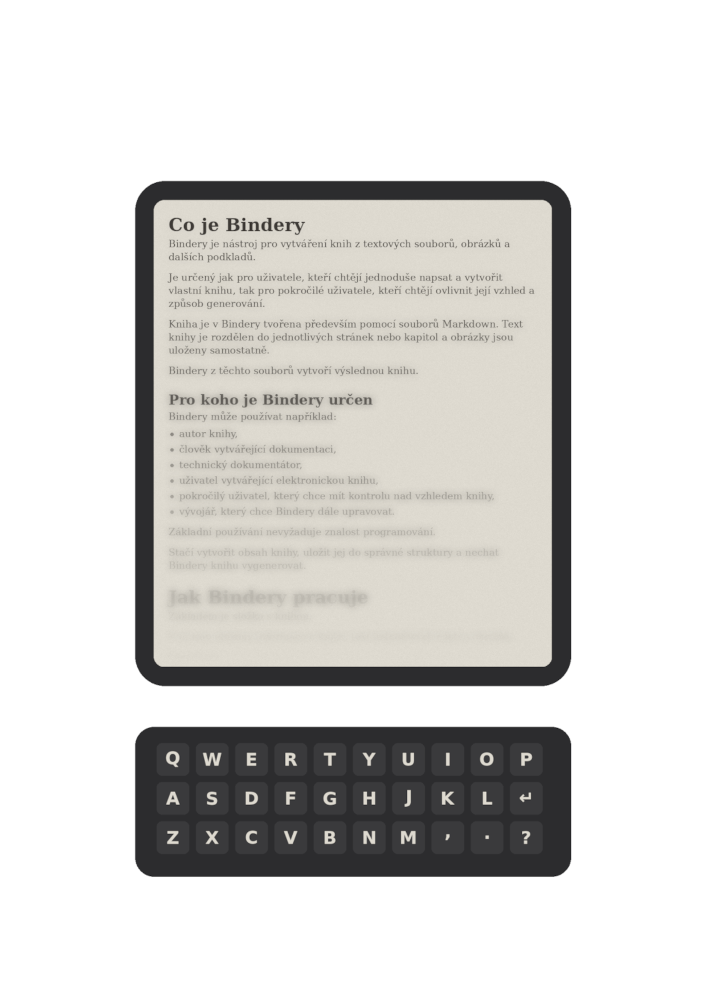

# O projektu

---

 
Nástroj pro tvorbu vlastních knih z textových souborů Markdown. Umožňuje připravit obsah knihy a převést jej do výsledné podoby pro digitální i tiskové publikování.
  
**Vývojář:**  
Wajsar Josef
  
**Kontakt:**  
E-mail: [Wajsar.Josef@hotmail.com](mailto:Wajsar.Josef@hotmail.com)  
Zdrojový kód: [Github](https://github.com/PepikVaio/macOS_Bindery)
  

---

  

*Vytvořeno pomocí Bindery 2026.*
